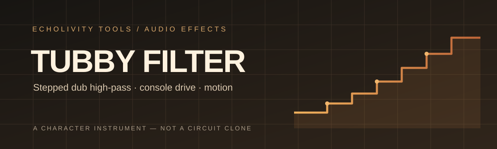

<div align="center">

# Tubby Filter

**A stepped dub high-pass with console drive for Ableton Live.**

A hands-on character instrument inspired by the switched filters dub engineers worked into the mixing desk.

[Features](#features) · [Install](#install) · [Controls](#controls) · [Build and test](#build-and-test) · [Validation](#validation-and-known-limitations)


</div>

> **Status: 2.2 beta — build 2.2.0-rc5.** Confirmed by the author on Ableton Live 12 for Windows: it loads, makes sound, and the Filter knob maps to Live's LFO in Mod mode. macOS, older Live versions, and the full native QA checklist are not yet tested. Bug reports are welcome; include OS, Live and Max versions.

**Requirements:** Ableton Live 12 Suite, or Live 12 Standard with the Max for Live add-on.

## Features

- 12 stepped high-pass positions: FLAT, 70, 100, 150, 250, 500, 1k, 2k, 3k, 5k, 7.5k and 10k Hz.
- Resonance Q 0.5–8 and console-style drive from clean to +18 dB.
- Glide for smooth transitions; Click for switch transients at any Glide setting.
- Motion adds velocity-sensitive resonance bloom while the cutoff moves.
- Link / Dual / Mono stereo modes, 12 / 18 dB slopes, output and dry/wet mix.
- Live LFO mapping, including Mod mode.

This is a **character model, not a circuit clone**. It is not affiliated with or endorsed by King Tubby's estate or any hardware maker.

## Install

1. Drag [`device/Tubby Filter.amxd`](device/Tubby%20Filter.amxd) onto an audio track.
2. If Live rejects the device, open [`device/Tubby Filter.maxpat`](device/Tubby%20Filter.maxpat) in Max and choose **File → Save As Device…**.

See [Windows build instructions](docs/BUILD_WINDOWS.md).

## Controls

V2.1 control names, ranges, defaults and layout are unchanged, with Motion added.

| Control | Parameter | Range (default) | Function |
|---|---|---|---|
| Filter | `Tubby Filter` | FLAT, 70–10k Hz (FLAT) | Stepped high-pass |
| Filter R | `Filter R` | Same (FLAT) | Right cutoff in Dual mode |
| Reso | `Reso` | Q 0.5–8 (1.4) | Resonance |
| Drive | `Drive` | 0–100% (20) | Saturation, 0 to +18 dB |
| Output | `Output` | −24 to +12 dB (0) | Output level |
| Glide | `Glide` | 0–2000 ms (0) | Cutoff transition; 0 = hard switch |
| Click | `Click` | 0–100% (30) | Switch transient |
| Mix | `Mix` | 0–100% (100) | Phase-aligned dry/wet |
| Motion | `Motion` | 0–100% (0) | Movement-sensitive resonance bloom |
| Slope | `Slope` | 12 / 18 dB (18) | Filter slope |
| Stereo | `Stereo` | Link / Dual / Mono (Link) | Stereo behaviour |
| Drive Cal | `Drive Cal` | Peak / Unity (Unity) | Drive calibration |
| Mode | `Mode` | Filter / Drive (Filter) | Drive mode bypasses filter |

### LFO starting points

Every knob can be mapped with Live's LFO, including in Mod mode. Filter and Filter R move through 0–11 and snap to the nearest step.

- Glide 200–500 ms: smooth sweeps.
- Click 0: silent steps.
- Increase Motion for a resonance bloom as the LFO moves the filter.

### Motion behaviour

Motion responds to **cutoff speed**, not cutoff position. Speed is measured in octaves per second and mapped from 0 to 1 (8 oct/s gives half), then shaped by a 2 ms attack / 120 ms release envelope. It multiplies filter Q by up to **1 + 4 × Motion**.

The cutoff path is not changed. With a stationary cutoff, any Motion setting sounds exactly like Motion 0; both behaviours are reported bit-exact in simulation.

**Simulated at 48 kHz:** slow 2 s glides +0.3 dB; medium/fast 300–50 ms glides +4 to +6 dB; hard steps about +3.7 dB at 20 ms loudness, decaying about 20 dB within 0.3–0.4 s.

## Validation and known limitations

The automated DSP suite runs the shipped GenExpr source through GSX on Linux. This is **simulation**, not native gen~ or Ableton validation. Apart from the author's Live 12 Windows checks above, the native QA checklist remains incomplete.

Known issues in [`validation/V22_KNOWN_ISSUES.md`](validation/V22_KNOWN_ISSUES.md):
- **KI-01:** faint transient on hard steps at high Motion.
- **KI-04:** tones sitting on a fast-moving resonance can become noticeably louder.

See [`validation/ABLETON_LIVE_12_QA.md`](validation/ABLETON_LIVE_12_QA.md) for the native test plan.

## Build and test

Build requires Python 3.10+. Tests additionally require `numpy scipy numba matplotlib pytest`.

```bash
python3 src/build_device.py
python3 -m pytest -q tests experiments
TUBBY_TARGET=v2.1 python3 -m pytest -q tests/test_regression.py
python3 validation/v22_report.py
python3 validation/make_signals.py 44100 48000 96000
```

The build script supports `--v21` and `--candidate`. See [`docs/BUILD_WINDOWS.md`](docs/BUILD_WINDOWS.md).

## Project map

| Path | Purpose |
|---|---|
| `src/tubby_filter.genexpr` | V2.2 DSP source of truth |
| `src/build_device.py` | Deterministic device build |
| `device/` | Max for Live device and build manifest |
| `legacy/v2.1/` | Frozen V2.1 source/device and SHA-256 |
| `tools/` | GSX executor, static gen~ audit, halfband utilities |
| `tests/` | V2.2 and V2.1 regression suites and reference models |
| `validation/` | Test methodology, reports, capture kit, latency/phase and known issues |
| `reports/v22/` | Measurements, plots and generated reference/demo audio |
| `docs/` | DSP architecture, Windows build, changelog and test methodology |
| `experiments/`, `research/` | Experimental research material |

## Licence

Tubby Filter is free software under the **GNU General Public License v3.0**. It is provided without warranty. See [`LICENSE`](LICENSE).

Copyright (C) 2026 the Tubby Filter authors.

---

<div align="center">

**ECHOLIVITY TOOLS** · Built for hands-on music making.

</div>
