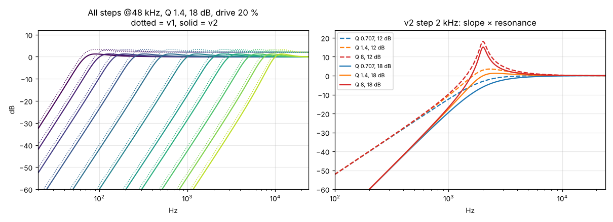
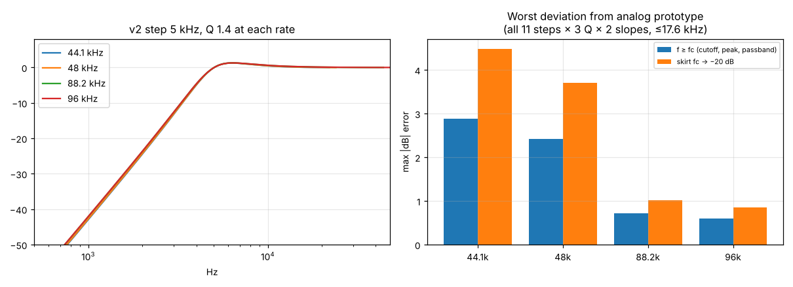
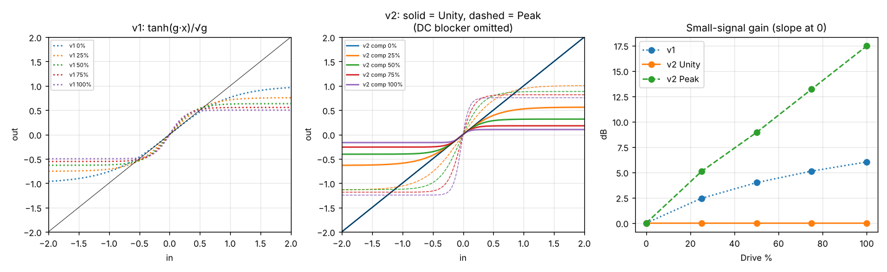
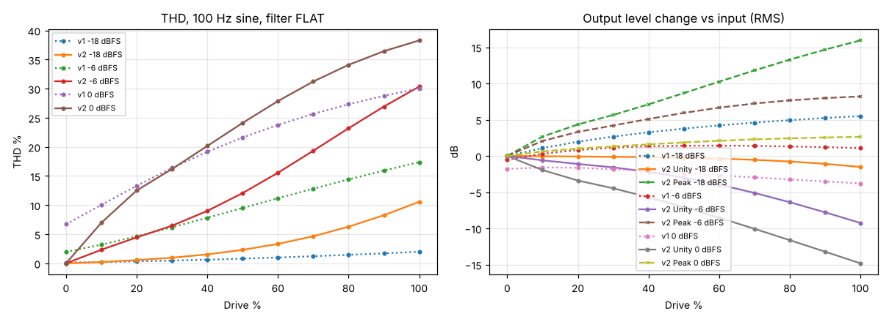
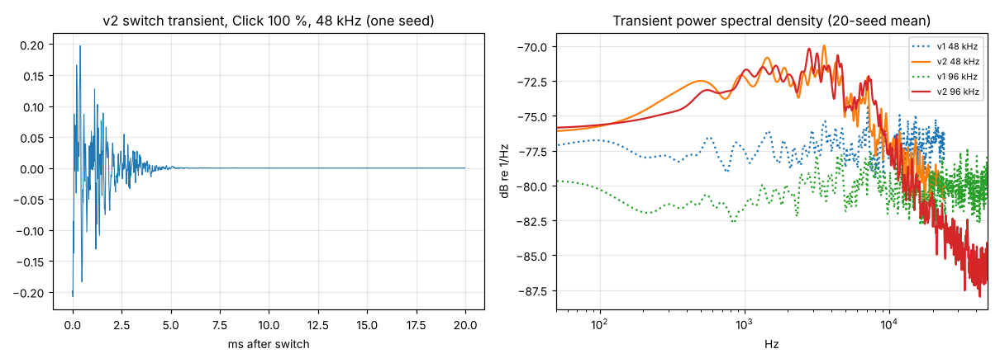

# Measurements

**Method.** `tests/model.py` reimplements the v1 and v2 gen~ code line by line in Python (compiled with numba). `tests/measure.py` produces every number and plot here, and the raw output is in `results.json`. Rates tested: 44.1, 48, 88.2 and 96 kHz.

**What these are not.** They are not measurements taken inside Max or Live, and gen~'s own compiled code was not run here. The model mirrors the gen code exactly (same equations, constants and order), but before release, the device should be checked in Live on real hardware. See the checklist at the end.

## Frequency response, before and after

Left: all 11 steps, v1 dotted and v2 solid, at 48 kHz with the default settings. The curves have the same shape. v1 sits **+2.04 dB** high because of its drive gain error, while v2 sits at **+0.005 dB**. Right: v2 at the 2 kHz step across slope and Q. Q 8 peaks at about +18 dB.

Worst deviation from the ideal analog high-pass, checked over all 11 steps × 3 Q values × 2 slopes, up to 17.6 kHz:

| Rate | Cutoff, peak and passband | Skirt (fc down to −20 dB) |
|---|---|---|
| 44.1 kHz | 2.88 dB | 4.48 dB |
| 48 kHz | 2.42 dB | 3.70 dB |
| 88.2 kHz | 0.71 dB | 1.01 dB |
| 96 kHz | 0.60 dB | 0.85 dB |

All of the larger errors come from the 5k, 7.5k and 10k steps (bilinear warping). Steps up to 3 kHz stay within 0.4 dB at 44.1 kHz. Passband gain at 20 kHz is **0.000 dB for every step** from 70 Hz to 7.5 kHz.

## Drive transfer function

Small-signal gain (dB) at Drive 0 / 25 / 50 / 75 / 100 %:

| | 0 | 25 | 50 | 75 | 100 |
|---|---|---|---|---|---|
| v1 | 0.00 | +2.43 | +3.98 | +5.12 | +6.02 |
| v2 Unity | **0.00** | **0.00** | **0.00** | **0.00** | **0.00** |
| v2 Peak | 0.00 | +5.08 | +8.93 | +13.20 | +17.46 |

100 Hz sine, filter FLAT, 48 kHz. THD % and output level change (dB):

| Input | Drive | v1 THD | v2 THD | v1 level | v2 Unity level | v2 Peak level |
|---|---|---|---|---|---|---|
| −18 dBFS | 0 % | 0.13 | 0.00 | −0.03 | 0.00 | 0.00 |
| −18 dBFS | 50 % | 0.81 | 2.31 | +3.77 | −0.26 | +8.67 |
| −18 dBFS | 100 % | 1.99 | 10.57 | +5.50 | −1.53 | +15.94 |
| −6 dBFS | 50 % | 9.51 | 12.07 | +1.40 | −2.99 | +5.93 |
| −6 dBFS | 100 % | 17.39 | 30.36 | +1.08 | −9.25 | +8.21 |
| 0 dBFS | 0 % | 6.71 | 0.00 | −1.79 | 0.00 | 0.00 |
| 0 dBFS | 100 % | 30.04 | 38.29 | −3.79 | −14.83 | +2.64 |

In Unity mode, turning Drive up never makes the output louder; the largest increase measured is 0.00 dB. It does make loud material quieter, which is the expected price of a fixed small-signal gain. Use Output to make up the level.

## Switching

| Rate | Level change from switching 100 Hz → 2 kHz (12 kHz tone) v1 / v2 | Largest sample step during a hard switch ÷ steady state | Same, with 50 ms glide |
|---|---|---|---|
| 44.1k | 0.034 / 0.034 dB | 1.135 | 1.011 |
| 48k | 0.038 / 0.038 dB | 1.135 | 1.011 |
| 88.2k | 0.054 / 0.054 dB | 1.135 | 1.011 |
| 96k | 0.055 / 0.055 dB | 1.135 | 1.011 |

A hard switch with Click at 0 produces a waveform step only 13.5 % larger than the signal's normal sample-to-sample change, and the figure is the same at all four rates. With glide, the switch is indistinguishable from steady state (1.011).

In the right-hand plot, v2's spectral density at 48 and 96 kHz overlays. v1's audible band drops by about 3 dB at 96 kHz, because its white noise spreads into the ultrasonic range.

Switch transient at Click 100 %:

| Rate | v1 RMS | v2 RMS | v1 share in 16–20 kHz | v2 share in 16–20 kHz |
|---|---|---|---|---|
| 44.1k | −33.2 dBFS | −32.0 dBFS | 17.4 % | 7.5 % |
| 48k | −33.2 | −32.0 | 19.8 % | 6.7 % |
| 88.2k | −33.4 | −32.0 | 24.2 % | 8.4 % |
| 96k | −33.3 | −31.6 | 23.5 % | 7.0 % |

## Robustness (v2, all four rates)

These were stress tests: 3 s of full-scale noise with a random step change every 10 ms, and Click at 100 %.

| Test | Result at 44.1 / 48 / 88.2 / 96k |
|---|---|
| Q 8, 18 dB, Drive 100 %, Peak calibration | finite, peak +8.0 dBFS (stopped by the safety ceiling) |
| Q 8, 12 dB, Glide 50 ms | finite, peak +6.2 / +6.3 / +3.7 / +4.1 dBFS |
| Q 8, Dual mode with opposite steps | finite |
| Q 0.5, Output +12 dB | finite, at the ceiling |
| NaN and Inf injected at the input | output stays finite and recovers |
| Impulse followed by 5 s of silence | tail below −400 dBFS, 0 subnormal samples |
| Link: same signal on L and R | L and R bit-identical |
| Mono mode | L = R bit-identical |
| Dual (L 1 kHz, R 70 Hz) | −3 dB points at 854 Hz and 60 Hz (Q 1.4, 18 dB) |

## CPU and latency

- **Latency: 0 samples**, measured as the position of the impulse peak in FLAT. Group delay at 10 kHz on the 1 kHz step is 0.003 ms. Nothing needs to be reported to Live's delay compensation.
- **CPU (proxy only)**: the compiled Python model takes about 155–175 ns per stereo sample, which is 0.7 % of one core at 44.1 kHz and 1.6 % at 96 kHz (single-threaded, on this machine). gen~ compiles to comparable native code, so expect a similar order of magnitude in Live. **This was not measured in Live.**

## Still to verify in Live (not possible here)

1. The .amxd loads. If it doesn't, open the .maxpat in Max and use Save As Device.
2. The gen~ codebox compiles without errors. Check the Max console.
3. CPU use in Live's CPU meter, with the device on 8 tracks at 96 kHz.
4. A saved set restores every control and makes no click on load.
5. Automating Filter in Arrangement view steps cleanly.
