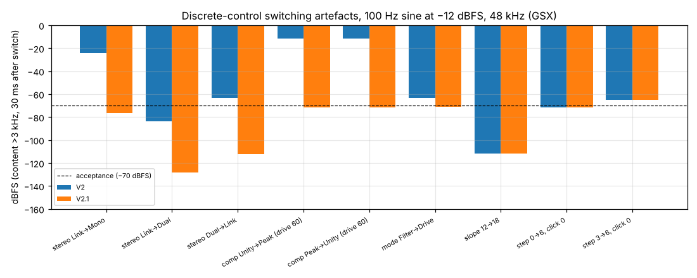
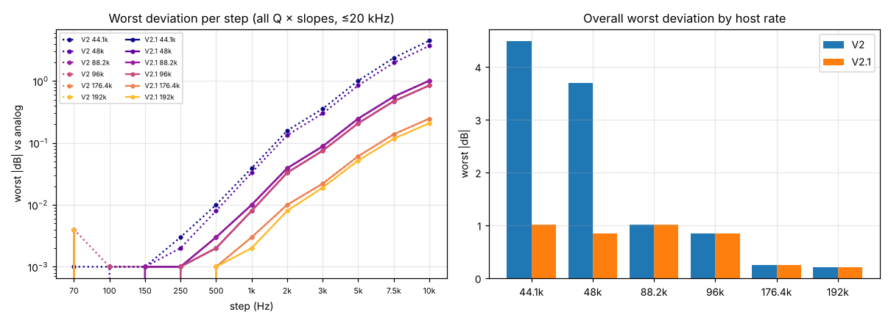
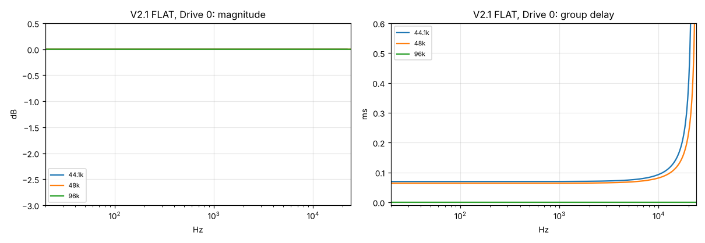
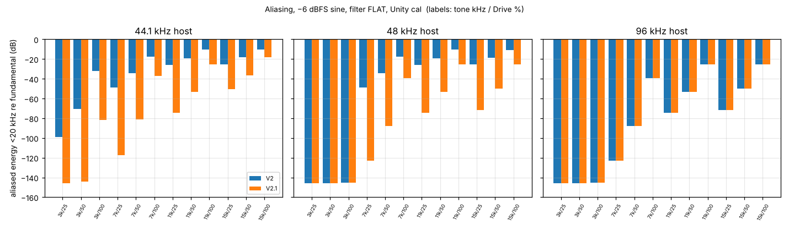

# Tubby Filter 2.1 — DSP measurement report

**Every number in this report is [sim]**: the shipped `.genexpr` sources of V2 (`legacy/v2`) and V2.1 (`src/`) were executed by `tools/gsx.py`. **No figure here was measured in gen~ or in Ableton Live.** The Live measurements are defined in `validation/LIVE_VALIDATION.md` and have not been performed.

Regenerate with `python3 tests/measure_v21.py`; the raw data is in `measurements_v21.json`. The V2 "before" run is `baseline_v2.json`.

## A. Discrete-control transitions

The input was a 100 Hz sine at −12 dBFS (L and R in different phase). Each figure is the peak of content above 3 kHz within 30 ms of the switch, at 48 kHz. Results at 44.1 and 96 kHz agree within 0.5 dB (see the JSON).

| Switch | V2 | V2.1 | Acceptance ≤ −70 |
|---|---|---|---|
| Stereo Link→Mono | −24.0 | −76.6 | pass |
| Stereo Link→Dual | −83.4 | −128.0 | pass |
| Stereo Dual→Link | −63.2 | −112.3 | pass |
| Drive Cal Unity→Peak (Drive 60) | −11.8 | −71.4 | pass |
| Drive Cal Peak→Unity (Drive 60) | −11.8 | −71.3 | pass |
| Mode Filter→Drive | −63.4 | −71.2 | pass |
| Slope 12→18 | −111.6 | −111.5 | pass |
| Filter step 3→6, Click 0 | −64.8 | −64.8 | n/a: intended hard-switch character, unchanged |

**Rapid toggling** (switching every 25 ms for 1.5 s, worst case):
- Stereo cycling: −23.4 → −76.2 dBFS.
- Drive-only: −63.1 → −70.9 dBFS.
- Slope: −111.2 → −111.0 dBFS.
- **Drive Cal: −10.1 → −69.6 dBFS.** This is 0.4 dB above the single-switch bar, because the 20 ms crossfade never completes when toggled 40 times a second. It is recorded as measured, not tuned away.

## B. Click / Glide

Silence in, Click 100 %, 48 kHz. RMS of the 30 ms after the event, in dBFS (−300 = exactly silent):

| Event | V2 | V2.1 |
|---|---|---|
| Step move, Glide 0 ms | −32.6 | −32.6 |
| Step move, Glide 1 / 50 / 300 / 2000 ms | silent | −32.6 (identical) |
| Stereo Link→Dual with Filter R different | −35.7 (unintended click) | silent |
| Device load with a saved step | silent | silent |
| Sample-rate change | silent | silent |

Steps every 2 ms peak at −8.2 dBFS, against −11.2 dBFS for a single step. Bursts restart rather than stack.

## C. Frequency-response accuracy

Worst |error| against the analog prototype, in dB, over all 11 steps × Q 0.707/1.4/8 × both slopes, up to min(20 kHz, 0.4·fs). Each cell shows the cutoff/peak/passband error, then the skirt error.

| Host rate | V2 | V2.1 |
|---|---|---|
| 44.1 kHz | 2.88 / **4.48** | 0.71 / 1.01 |
| 48 kHz | 2.42 / 3.70 | 0.60 / 0.85 |
| 88.2 kHz | 0.71 / 1.01 | 0.71 / 1.01 (unchanged) |
| 96 kHz | 0.60 / 0.85 | 0.60 / 0.85 (unchanged) |
| 176.4 kHz | 0.18 / 0.25 | 0.18 / 0.25 (unchanged) |
| 192 kHz | 0.15 / 0.21 | 0.15 / 0.21 (unchanged) |

- **Cause**: bilinear frequency warping (DSP_ARCHITECTURE §3).
- **Fix**: an internal rate of at least 88.2 kHz. 44.1 now matches 88.2 exactly, and 48 matches 96.
- **Remaining error**: the 10 kHz step only. Steps up to 3 kHz are within 0.09 dB at every rate.

The oversampler at FLAT and Drive 0 is flat to 20 kHz within 0.0001 dB. Its group delay at 44.1 kHz is 3.08 samples at 1 kHz, 4.11 at 10 kHz and 10.2 at 18 kHz. At 48 kHz it is 3.07, 3.92 and 7.89. Natively processed rates have 0 samples of delay.

## D. Drive: harmonics and aliasing

The input was a −6 dBFS sine with the filter at FLAT and Drive Cal on Unity. The figure is aliased energy below 20 kHz relative to the fundamental, in dB (V2 → V2.1):

| Tone | Drive | 44.1 kHz | 48 kHz | 96 kHz |
|---|---|---|---|---|
| 3 kHz | 50 % | −70.6 → −144.3 | no change (≤ −145) | no change |
| 7 kHz | 25 % | −48.7 → −117.5 | −48.7 → −123.1 | −123.1 (no change) |
| 7 kHz | 50 % | −34.3 → −81.2 | −34.4 → −87.9 | −87.9 (no change) |
| 7 kHz | 100 % | −17.6 → −37.0 | −17.6 → −39.2 | −39.2 (no change) |
| 11 kHz | 50 % | −19.1 → −53.4 | −19.1 → −53.4 | −53.4 (no change) |
| 15 kHz | 50 % | −18.4 → −36.3 | −18.5 → −50.1 | −50.1 (no change) |
| 15 kHz | 100 % | −10.4 → −18.3 | −11.1 → −25.3 | −25.3 (no change) |

- **Was oversampling needed?** Yes. At 44.1/48 kHz, V2 aliased at −34 dB for a 7 kHz tone at moderate drive, which is audible on hats and cymbals. 2× oversampling lowers this by 25–70 dB at moderate drive.
- **What remains**: at full drive on very high tones aliasing is still significant (Known limitations).
- **Drive character**: harmonics 2–7 of a 100 Hz tone (−18/−6/0 dBFS × Drive 25/50/100) differ from V2 by at most **0.001 dB**.

## E. Numerical stability (all six rates)

| Test | Result |
|---|---|
| NaN, ±Inf and 1e30 injected into the input | Finite output; peak +8.0 dBFS (safety ceiling); recovers |
| Parameters jumping between their extremes every 5 ms | Finite; peak ≤ +8.0 dBFS |
| Every parameter randomised every sample | Finite; peak ≤ +4.6 dBFS |
| Out-of-range parameter values (1e9, −5, …) | Clamped; finite; peak ≤ +8.0 dBFS |
| Impulse followed by 4 s of silence | Tail ≤ 4e-36; zero subnormal samples |
| +0.5 DC input, 70 Hz step / FLAT with Drive 80 % | Residual ≤ 1.4e-13 after 1 s |
| Sample-rate change 44.1→96→48 kHz and device off/on while playing | Finite. Re-activation is seamless. Each rate change has a one-sample hand-over of up to 2× normal signal motion. |

## Stereo and calibration
- **Link**: identical input gives bit-identical L/R.
- **Mono**: L = R bit-exact after the 10 ms start-up ramp.
- **Crosstalk**: a left-only input gives exactly 0 on R in Link and Dual.
- **Unity small-signal gain** at −40 dBFS, 1 kHz: 0.000 / −0.0003 / −0.0095 dB at Drive 0 / 50 / 100.
- **Output control**: −24, −6, 0 and +12 dB are accurate to 0.0001 dB.
- **Noise floor**: silence in gives exactly 0 out, at Drive 100, Q 8 and Click 100 with no step moves.

## CPU (proxy only, not Live)
This is the GSX-compiled source timed on the development machine, in ns per stereo frame. **The figures are relative only.** Real CPU is test L13 in LIVE_VALIDATION.md.

| Host rate | V2 | V2.1 | Ratio | V2.1, 8 instances (% of one core) |
|---|---|---|---|---|
| 44.1 kHz | 316 | 454 | 1.44× | 16.2 % |
| 48 kHz | 315 | 447 | 1.42× | 17.7 % |
| 88.2 kHz | 322 | 343 | 1.07× | 26.3 % |
| 96 kHz | 314 | 348 | 1.11× | 28.0 % |
| 176.4 kHz | 345 | 352 | 1.02× | 55.4 % |
| 192 kHz | 338 | 384 | 1.14× | 58.9 % |

Oversampling costs about 40 % more at 44.1/48 kHz. That is less than 2×, because the per-frame control work is shared. At native rates the cost is within run-to-run noise of V2 (±10 %). Eight instances scale linearly.
