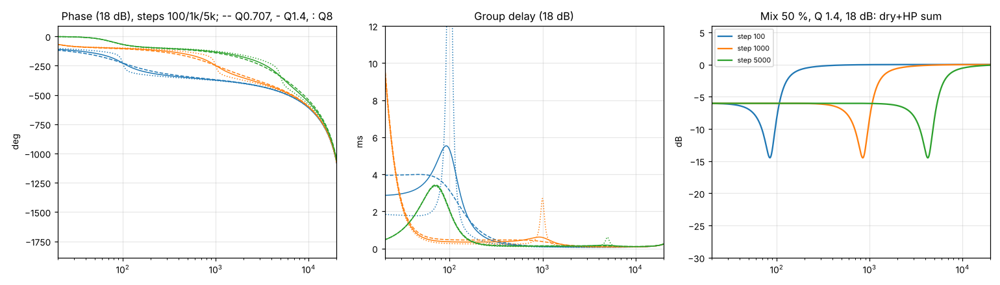
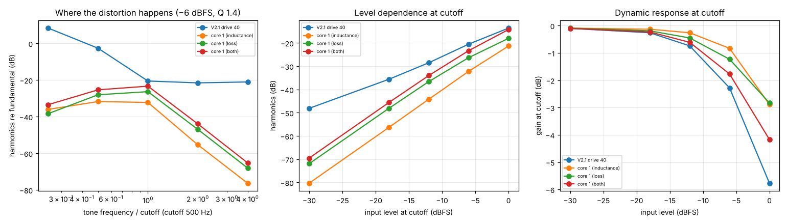
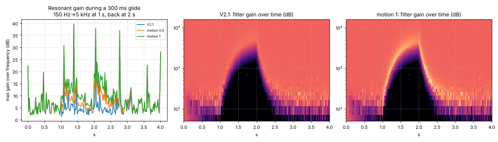
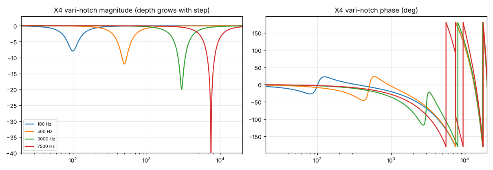

# V2.2 DSP experiments

## How to read this report
- **Implementation.** `experiments/exp_model.py` is the V2.1 reference model plus switchable experiments. With every experiment off it is **bit-identical to V2.1** (tested at 44.1 and 96 kHz with random steps, stereo modes, drive, glide and click).
- **Reproducing.** `experiments/run_experiments.py` produces every number here (`experiments/results.json`, plots in `experiments/img/`). `experiments/bench.py` produces the CPU figures (`experiments/bench.json`).
- **Labels.** Every measurement is **[ref-model]**: simulated, not gen~, not Live. The one exception is the Motion candidate, which was also run as GenExpr source through GSX (**[sim]**, bit-exact with the model).
- **Listening: NOT PERFORMED.** I can't listen to audio. Level-matched renders for a human listening test are in `experiments/renders/` (§9). **No statement in this report is a listening observation.** Where a sonic effect is described, it is the *expected* result, inferred from the measurements.
- **Signals.** Impulses, sines, multitones (via harmonic analysis), pink noise (fixed seed), and a synthetic dub loop (fixed seed). Rates: 44.1, 48, 88.2 and 96 kHz.

---

## P. Phase response of the V2.1 filter (baseline study)
**What was measured.** Phase and group delay of the shipped filter, and how it interacts with the dry signal at Mix 50 %.

| 18 dB/oct, Q 1.4 | Phase at fc | Group delay at fc | Peak group delay |
|---|---|---|---|
| 100 Hz step | −227° | 5.33 ms | 5.53 ms |
| 1 kHz step | −248° | 0.59 ms | 0.61 ms |
| 5 kHz step | −342°¹ | 0.18 ms | 0.23 ms |

¹ This includes about 2 samples of oversampler delay at 48 kHz.

- **Group delay** scales as 1/fc, so the 70–150 Hz steps delay the low end by several milliseconds. That matters when the filter output is blended with the dry signal, or with an unfiltered copy on another track.
- **Mix 50 % (dry + high-pass)** produces a cancellation dip at 0.78–0.87 × fc. It is −9.3 dB at Q 0.707, −14.5 dB at Q 1.4 and −10.0 dB at Q 8, and the same at every step. **This is the "phasing when blended with dry" effect the KTBK documentation describes.** It moves with every step change, so stepped sweeps at partial Mix produce phasing.
- **Recommendation: keep it.** It's a characteristic, not a defect. Document it in the manual as the *phasing* use of Mix.

## X5. Altec / KTBK "600" response mapping
- **Changed:** nothing. This is an analysis.
- **Why:** to find out whether the original 3rd-order passive response needs its own mode.
- **Measured:** V2.1 at **Reso 1.0 + Slope 18 dB** matches an ideal 3rd-order Butterworth high-pass (1-pole at fc times 2-pole with Q 1 at fc) within **0.096 dB at 44.1/88.2 kHz and 0.081 dB at 48/96 kHz**. The residual comes from bilinear warping on the top step.
- **Caveat:** that the Altec 9069B is Butterworth-like is a *hypothesis*. Passive doubly-terminated LC ladders usually are, but the real unit wasn't measured.
- **Recommendation: IMPLEMENT as documentation only.** "Reso 1.0 + 18 dB ≈ the original passive response." Optionally, add a detent or marker at Reso 1.0. No new mode.

## X1. Non-linear inductance ("core")
- **Changed:** the shunt inductor's current (the SVF band-pass state) now changes the filter on every sample, using the previous sample's state. **Inductance** variant: the cutoff rises with current (`g·√(1+2c·i²)`), as a saturating core lowers L. **Loss** variant: damping rises with current (`k·(1+2c·i²)`), as core loss would. **Both** applies the two together.
- **Why:** AudioThing's Magnetism, Character and Dynamics describe a non-linear inductance model. This tests whether such a model does anything that the existing Drive doesn't.
- **Expected:** distortion concentrated around the cutoff rather than across the whole band, rising with level, plus a resonance that compresses on loud signals.

**Measured** (500 Hz step, Q 1.4, 18 dB, input −6 dBFS, 48 kHz). Absolute harmonic level in dBFS against tone frequency relative to the cutoff:

| | 0.25·fc | 0.5·fc | fc | 2·fc | 4·fc |
|---|---|---|---|---|---|
| V2.1 Drive 40 % | −35.9 | −28.2 | −28.8 | −29.1 | −29.1 |
| Core 1, inductance | −78.1 | −55.4 | −39.1 | −60.7 | −82.1 |
| Core 1, loss | −80.4 | −51.4 | −33.6 | −52.3 | −73.9 |
| Core 1, both | −75.6 | −49.0 | **−31.1** | −49.3 | −71.0 |

- **The core distortion is a band around the cutoff,** about 20 dB down an octave either side and about 40 dB down two octaves away. The passband above stays clean. Drive distorts everything equally. **This is a genuine difference in kind, not in amount.**
- **Level dependence at fc** (harmonics relative to the fundamental, from −30 to 0 dBFS input): with Core it falls from −70/−80 dB to −14/−21 dB, a slope of about 2 dB per dB (3rd-order-like). Drive 40 % goes from −48 to −14 dB. **Core stays clean at low levels and wakes up when pushed.**
- **Dynamic resonance:** the gain at fc drops by 2.8–4.2 dB at 0 dBFS input, against about 0.1 dB at −30 dBFS. The resonance tames itself on loud material.
- **Aliasing** (6 kHz tone on the 5 kHz step, Q 4): −111 dB at 44.1 kHz (with the 2× oversampling) and −146 dB at 96 kHz. Not a concern.
- **Stability:** at Q 8, Drive 100 %, Peak calibration, Output +12 dB, a cutoff change every 4 ms and Core 1, the output stays finite at every rate, peaking at +8.0 dBFS (the safety ceiling).
- **CPU:** +0 to +15 % over V2.1, which is within this machine's measurement noise (§8).
- **Authenticity:** the KTBK hardware specifies THD < 0.01 % at +17 dBu. Real Altec-style inductors are effectively linear at line level, so **Core is a creative character, not a replica behaviour.**
- **Listening: NOT PERFORMED.** Render `B_core.wav`.
- **Recommendation: EXPERIMENT.** It is measurably distinctive and stable, but it needs a new control, overlaps conceptually with Drive, and its musical value depends on listening. If adopted, ship the "both" variant only, as a single "Core" amount, not three controls.

## X2. Movement-dependent filter behaviour ("Motion") — the central question
- **Changed:** the filter's damping now depends on **how fast its cutoff is moving.** The cutoff velocity, in octaves per second, is taken from the existing glide state. It feeds an envelope (2 ms attack, 120 ms release), mapped as `m = v/(v+8 oct/s)`, and Q is multiplied by `1 + 4·Motion·m`.
- **Position is untouched by construction.** The cutoff is computed from the same glide state as V2.1, and Motion only scales the damping. With Motion 0 the factor is exactly 1.0, so the output is bit-identical to V2.1 (tested).
- **Why:** in V2.1 the filter responds only to where the knob is. Dub filtering is performed (see the Bass Culture notes), so the speed of the gesture should be audible.
- **Expected:** the resonance "sings" during a sweep and relaxes when the knob stops. A hard step gives a short resonant bloom at the new cutoff. A static setting is unchanged.

**Measured.** A single impulse was fired during a 300 ms glide from 150 Hz to 5 kHz (48 kHz). Ring energy, with the decay time to −40 dB in brackets:

| | Before the move | Mid-sweep (+100 ms) | Late sweep (+400 ms) | Settled (+1.5 s) |
|---|---|---|---|---|
| V2.1 | −22.95 dB (7.2 ms) | −22.49 dB (3.0 ms) | −23.59 dB (2.2 ms) | −23.13 dB (2.3 ms) |
| Motion 50 % | identical | **−20.01 dB (7.5 ms)** | −22.98 dB (2.2 ms) | identical |
| Motion 100 % | identical | **−18.25 dB (12.1 ms)** | −20.78 dB (2.6 ms) | identical (2.27 ms) |

- **Hard step** (150 Hz → 1 kHz, Glide 0, pink noise): energy in the 700–1400 Hz band over the first 80 ms after the step is **+7.4 dB above settled** with Motion 100 %, against −0.2 dB in V2.1. A switch now "speaks" with the filter's own resonance instead of only with the noise click.
- **Is this genuine hysteresis? No.** It is *rate-dependent* behaviour, not hysteresis. After settling, the gain at 1 kHz is identical whether the cutoff arrived from below or from above (−0.084 dB both ways). The effect depends on speed and leaves no lasting memory of the path.
- **Is it smoothing? No.** Smoothing changes *where* the cutoff is over time. Motion leaves the position trajectory alone and changes *what the filter does* while moving.
- **The effect decays, it doesn't switch off.** Because the one-pole glide approaches its target exponentially, Motion's influence decays exponentially too: about 40 dB every 0.5 s after a 50 ms glide. It is below −100 dBFS within 2 s of a move (tested).
- **Design flaw found and fixed during testing.** A Link↔Dual change moves the right cutoff internally over 20 ms. The first candidate treated that as a gesture and bloomed, producing −46 dBFS of artefact above 3 kHz. Now, during that crossfade, the right side takes the left side's speed, and every discrete switch stays below −70 dBFS with Motion 100 % (tested).
- **Genuine hysteresis, tested separately (X2h):** a rate-independent play operator, 0.25 octaves wide, on the cutoff. The settled gain at 1 kHz is +0.78 dB arriving from below and −1.48 dB arriving from above, and it is the same arriving fast or slow. **That is real path dependence. It makes the resting cutoff depend on how you got there, which conflicts with a stepped, predictable control. REJECT.**
- **Direction weighting** (`mdir`, rising moves weighted more): peak during a falling sweep 38.1 → 29.3 dB as mdir goes 0 → 1, with rising sweeps unchanged at 39.6 dB. It works as designed, but no physical mechanism justifies it, so any value is musical only. **EXPERIMENT,** not exposed.
- **Stability:** Motion 100 %, Q 8 (so effective Q up to 40), a new random step every sample or every 2 ms, Drive 100 %. The output stays finite at every rate, peaking at +6.2 to +7.6 dBFS, and the filter still rings down below −120 dB within a second (no self-oscillation). Every discrete switch stays below −70 dBFS with Motion 100 % (candidate tests).
- **CPU:** 0 to +14 % over V2.1, within measurement noise (§8). It adds about 15 operations and 2 `exp` calls per frame.
- **Listening: NOT PERFORMED.** Renders `C_motion.wav` and `E_core_motion.wav`.
- **Recommendation: IMPLEMENT, as a candidate pending listening and native validation.** It answers the brief's central question directly and measurably. It costs one new control, which defaults to 0 = V2.1, so it is fully backward compatible. It changes nothing at rest, it is stable, and it needs no extra latency. A gen~ candidate exists: `experiments/candidate/` (§10).

## X3. Switching transients that depend on the signal
- **Changed, variant A (gate):** a break-before-make gap of 0.25 ms plus two bounces, applied to the processed output.
- **Changed, variant B (inductive kick):** at the moment of the switch, the shunt-inductor current (band-pass state) is captured and decays into the output with τ = 0.3 ms.
- **Why:** V2.1's Click is noise that ignores the signal, while KTBK notes that passive switching clicks "especially with low-frequency material".

**Measured:** RMS of the added transient in the 5 ms after a 150 Hz → 1 kHz step (48 kHz), in dBFS.

| Input | V2.1 Click 100 | Gate | **Kick** |
|---|---|---|---|
| silence | −24.9 | silent | **silent** |
| 60 Hz −6 dBFS | −24.9 | −40.6 | **−28.3** |
| 100 Hz −6 dBFS | −24.9 | −34.4 | **−24.1** |
| 100 Hz −24 dBFS | −24.9 | −52.4 | **−42.1** (scales with level) |
| 3 kHz −6 dBFS | −24.9 | −19.9 | **−46.7** |
| pink −12 dBFS | −24.9 | −20.1 | −34.2 |

- **The gate variant does the opposite of the hardware:** it is loudest on high-frequency content. **REJECT.**
- **The kick variant reproduces the documented behaviour:** it is loudest on bass near the cutoff, quiet on treble, silent on silence, and proportional to level.
- **CPU:** within noise.
- **Stability:** bounded by construction, since it is a decaying copy of a bounded state.
- **Listening: NOT PERFORMED.** Renders `D_contact_gate.wav` and `D2_contact_kick.wav`.
- **Recommendation for the kick: EXPERIMENT.** It would most naturally become a second *character* of the existing Click control. But that would change what Click sounds like in V2 sets, which is a compatibility decision that needs listening first.

## X4. Vari-notch architecture
- **Changed:** an SVF notch replaces the high-pass, with depth growing with the step: −8 dB at 100 Hz, −12 dB at 500 Hz, −20 dB at 3 kHz, and a full notch at 7.5 kHz and above. This follows KTBK's "attenuation increases with frequency".
- **Phase:** ±20–40° on either side of the notch at the low steps, up to about ±170° at full depth.
- **Recommendation: REJECT for V2.2.** It is a new mode that moves Tubby towards a multimode filter, which the brief explicitly warns against. Mix 50 % already gives a moving cancellation dip of 9–14.5 dB (§P) with no new control. It can be revisited if listening shows the dip is not enough.

## X6. Component-tolerance variation
- **Not prototyped.** Already evaluated and rejected in V2: a per-step detune makes steps unpredictable live. A per-channel mismatch would also break Link's bit-identical L/R guarantee and its tested stereo-image integrity. **REJECT.**

## X7. Oversampling latency and host reporting
- **Measured** (null test of the processed signal against a dry copy, FLAT, Drive 0):

| Host rate | Latency reported to Live | Null at 100 Hz | 1 kHz | 5 kHz | 10 kHz |
|---|---|---|---|---|---|
| 44.1 kHz | 0 (V2.1) | −27.2 dB | **−7.3** | +5.1 | +2.5 |
| 44.1 kHz | 3 samples | −60.4 | **−40.0** | −20.1 | −5.3 |
| 48 kHz | 0 (V2.1) | −28.0 | −8.0 | +4.6 | +4.3 |
| 48 kHz | 3 samples | −61.1 | −40.8 | −21.5 | −7.4 |
| 96 kHz | 0 (V2.1), no OS | perfect | perfect | perfect | perfect |
| 96 kHz | 3 + constant-latency option | perfect | perfect | perfect | perfect |

- **Reading:** at 44.1/48 kHz, V2.1 blended with an uncompensated dry copy (for example on a parallel track) partly cancels from about 1 kHz upward. Declaring 3 samples of latency improves 1 kHz from −7 to −40 dB. The highest frequencies can't null completely, because the IIR oversampler's phase is non-linear (group delay rises from 3 samples at 1 kHz to 10 at 18 kHz).
- **Host reporting:** Max for Live devices can declare a fixed latency in samples through the patcher's *Defined Latency* attribute ([Cycling '74](https://docs.cycling74.com/max7/vignettes/live_audiodevices)). A fixed value can't be right at both 44.1 and 96 kHz, so experiment X7 adds an optional 3-sample delay at ≥ 60 kHz. That makes the latency 3 samples at every rate (0.03 ms at 96 kHz), and with it the 96 kHz null is perfect.
- **Whether Live actually compensates the declared latency: BLOCKED** (needs Live; test L15).
- **Linear-phase alternative:** a half-band FIR with the same ~100 dB rejection needs 63 taps, which is **31 samples of latency** (0.7 ms at 44.1 kHz) against the IIR's 3. **REJECT.** The brief rules out adding latency for numerical gain.
- **Higher oversampling factor:** no measured need beyond extreme drive on very high tones (V2.1 report). **REJECT.**
- **Recommendation for the reported latency plus the constant-latency option: IMPLEMENT, conditional on Live verification.** If Live is shown to compensate it, this fixes parallel-processing cancellation at 44.1/48 kHz for 3 samples of latency. Until then it stays in research.

## 8. CPU (proxy)
**Hardware:** Intel Xeon @ 2.10 GHz, 2 logical CPUs, Linux 6.18 (cloud VM). The figures are a single-threaded numba proxy: medians of 7 runs of 2 s. **They are not gen~ or Live CPU.**

| 44.1 kHz | 1 instance | 8 instances (measured) | 16 instances (measured) |
|---|---|---|---|
| V2.1, normal | 1.90 % | 14.8 % | 33.2 % |
| X1 + X2 + X3b, normal | 2.26 % | 18.7 % | 45.4 % |

| One instance, % of a core | normal | max drive | intensive modulation |
|---|---|---|---|
| 44.1k V2.1 / Motion / all | 1.90 / 2.17 / 2.26 | 2.64 / 2.28 / 2.19 | 1.83 / 2.02 / 2.41 |
| 48k V2.1 / Motion / all | 2.27 / 2.32 / 2.36 | 2.39 / 2.48 / 2.63 | 2.41 / 2.59 / 2.65 |
| 96k V2.1 / Motion / all | 3.64 / 3.64 / 3.93 | 3.54 / 3.72 / 4.08 | 3.89 / 4.05 / 4.17 |

- **Run-to-run spread on this VM is up to 43 %.** Some "experiment on" runs measured cheaper than V2.1 because of that noise. The supportable conclusion is that **each experiment costs 0–15 % more than V2.1, and all of them together cost 5–25 % more.** Finer resolution needs dedicated hardware, and real figures need Ableton's CPU Reporter in Live (test L13).
- **Latency:** no experiment adds latency except X7, which adds a deliberate 3 samples at ≥ 60 kHz.

## 9. Listening renders (for a human; not evaluated here)
`experiments/renders/*.wav` hold a 4-bar synthetic dub loop at 76 bpm, 44.1 kHz, 16-bit. The automation is:
- bar 1 FLAT;
- bar 2 rhythmic hard steps;
- bars 3–4 a 250 ms glide sweep.

Settings: Reso 2.5, Drive 25 %, Click 0. All renders are **RMS level-matched to A** (corrections between 0.00 and −0.32 dB).

| File | Variant |
|---|---|
| A_v21.wav | V2.1 baseline |
| B_core.wav | Core 0.7, inductance + loss |
| C_motion.wav | Motion 0.7 |
| D_contact_gate.wav | Contact gate 0.8 (rejected variant, kept for comparison) |
| D2_contact_kick.wav | Contact inductive kick 0.8 |
| E_core_motion.wav | Core 0.7 + Motion 0.7 |

**Suggested blind protocol:** ABX each of B–E against A, listening for the sweep bars (3–4) and the step bar (2). Record preferences in `research/05_VALIDATION_STATUS.md`.

## 10. The Motion candidate (gen~)
- **Files:** `experiments/candidate/tubby_filter_v22_candidate.genexpr` is the V2.1 source plus Motion, about 25 lines. `experiments/candidate/device/` holds the experimental .amxd and .maxpat, built with `python3 src/build_device.py experiments/candidate/device --candidate experiments/candidate/tubby_filter_v22_candidate.genexpr`.
- **[sim] checks, run by `pytest -q experiments`:**
  - It passes the GSX History lint.
  - Motion 0 is bit-exact with the V2.1 source at 4 rates under random automation of every parameter.
  - Motion 35 % and 100 % are bit-exact with the research model.
  - The bloom happens only while moving, and Motion's influence falls below −100 dBFS within 2 s of a move.
  - It is stable at the extremes, with no self-oscillation.
  - Discrete switches stay below −70 dBFS.
  - The build is reproducible, and the release build stays byte-identical.
- **Not merged** into `src/` or `main`.
